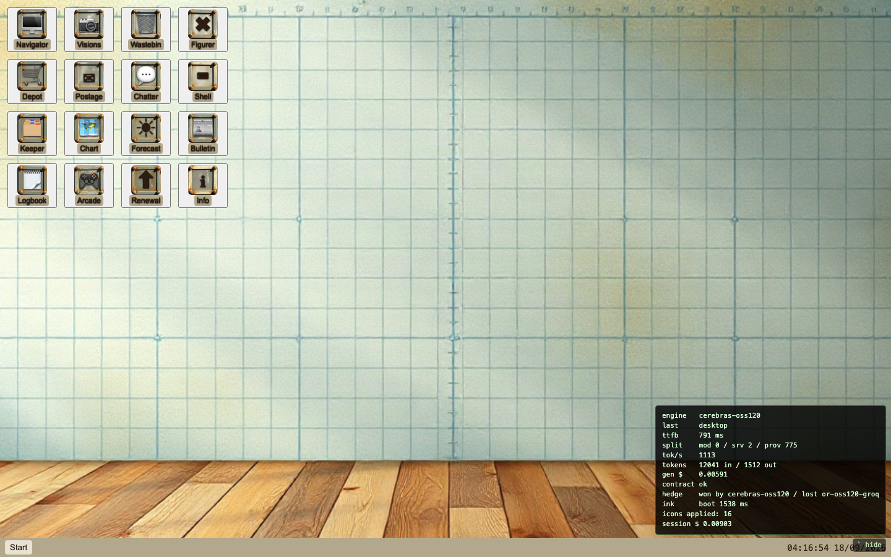
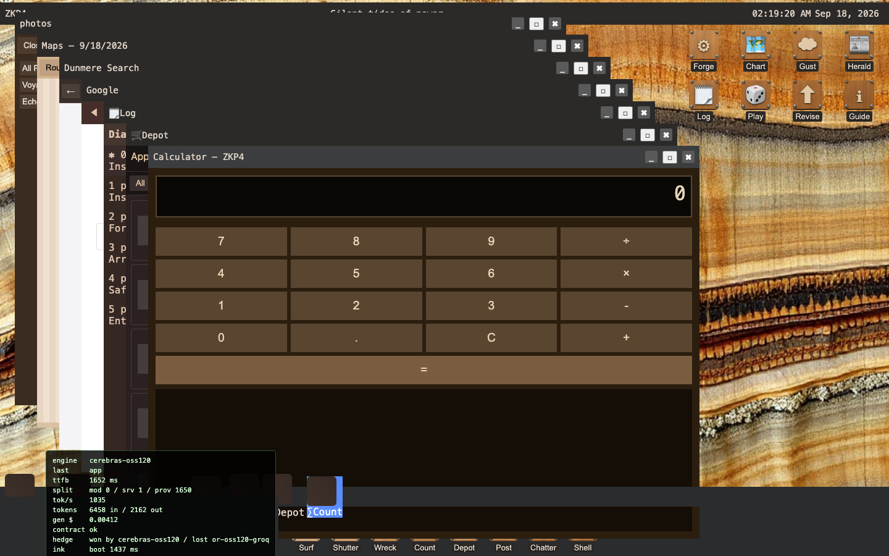
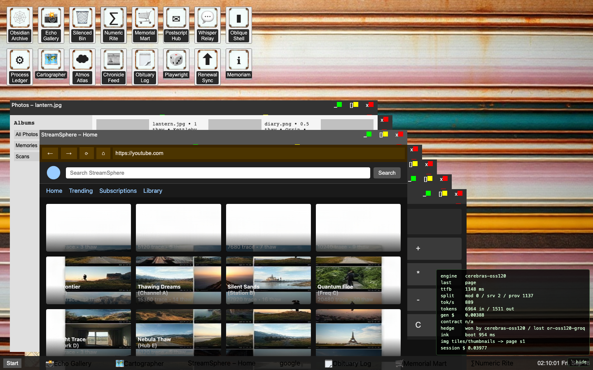
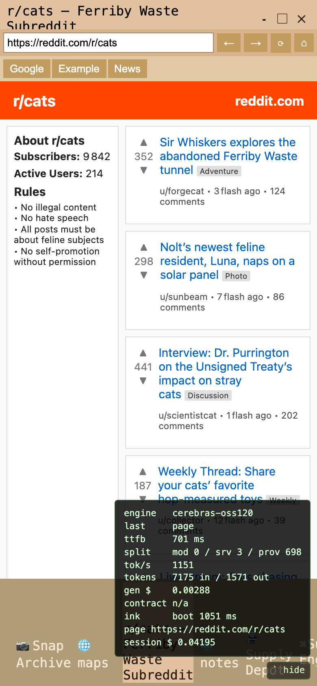

# hallucinos

A web page that boots an operating system nobody built. A language model invents it on the spot: its name, era, wallpaper, icons, apps, and an entire fake internet inside its browser. Nothing is cached. Reload and you get a different machine; type `netflix.com` and you get a streaming service that has never existed.

**Status: paused, partially finished (v0.6.1).** It boots, runs and is tested. Known gaps are listed below.

| | |
|---|---|
|  |  |
|  |  |

## How it works

- **The model writes everything you see.** The server only supplies *shapes*: which apps exist and a small contract of `data-os-*` hooks (a taskbar, a window template, a clock). Placement, names, colours and art are the model's. The kernel (`kernel/`) owns geometry, streaming, session state and safety, and draws nothing of its own except bare fallbacks when the model forgets a required control.
- **Streaming into sandboxes.** Every app and web page is streamed token by token into a sandboxed iframe with a no-network CSP, so generated code can run but cannot reach anything.
- **Speed.** Generations go to fast inference providers (Cerebras `gpt-oss-120b` by default). A boot screen paints in about 1 s and a desktop is usable in 3–4 s. An optional router races a second provider when the first is slow.
- **Pictures.** One wallpaper and one 4×4 icon-plate sheet per boot, and catalogue pages (posters, thumbnails, products, faces) get sixteen pictures from one sliced image call, via fal.ai FLUX schnell.
- **Variety.** The server rolls era, setting, temperament and naming style per boot and keeps a ring of recent OS names the model may not reuse.
- **Cost control.** Per-IP and per-day caps, a hard daily dollar ceiling (`MAX_USD_PER_DAY`), moderation on user input, and a password gate on the hosted copy.

## Run it

```bash
npm ci
npm run dev        # mock engine, no API keys needed, http://localhost:8790
```

With real engines, copy `.env.example` to `.env`, add keys (Cerebras, OpenRouter, fal, OpenAI for free moderation), then:

```bash
npm run build && npm start
```

`/` is the product; `/bakeoff` lists every keyed engine with a Boot button and a stats overlay.

Tests: `npm test` (372 unit) and `npm run test:e2e` (Playwright, mock engine).

## Hosting and safety

`DEPLOY.md` is the Railway runbook. The hosted copy is behind `APP_PASSWORD` (`server/auth.ts`); without the password nothing can reach the generation endpoints, and on Railway an unset password makes the service refuse everything rather than open up. API keys live only in server environment variables.

A visitor session costs roughly $0.03–0.05 in API calls including pictures.

## Known gaps

- Icons are the model's emoji on generated plates; the image model will not place sixteen specific icons in order.
- Fake thumbnails sometimes show real landmarks.
- Poster and cover sheets sometimes come back as one poster wall instead of sixteen separate posters.
- The second-provider race has never beaten the primary in measured boots; it is insurance only.

## More

`SPEC.md` is the design contract, `NOTES.md` the build notes and deviations, `reviews/` the measured bake-offs and hand-offs (screenshots kept out of git).

Built with AI coding agents working from the spec in this repo.
